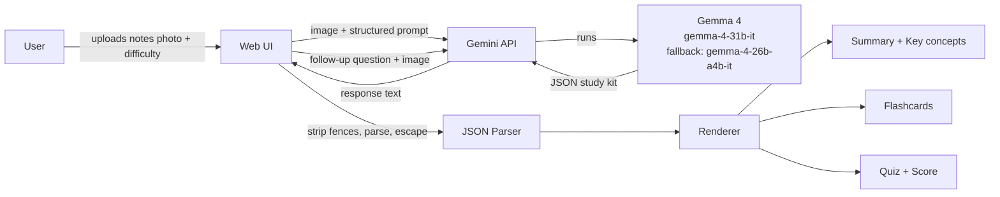

# 📸 Snap2Study

Turn a photo of your notes into a complete study kit in seconds, powered by **Gemma 4** (`gemma-4-31b-it` with automatic fallback to `gemma-4-26b-a4b-it`) through the Gemini API.

Built for the **Best Use of Gemma 4** challenge at Hacktoberfest Hack Day Hyderabad x Kramer's Community (MLH).

---

## What it does

Upload a photo of handwritten notes, a textbook page, a diagram, or a whiteboard. Gemma 4 reads the image directly (no separate OCR step) and generates:

- A plain-language **summary** (3-4 sentences) and **key concepts** (5-8 bullet points)
- 6 interactive 3D flip-able **flashcards** (question on front, answer on back)
- A 4-question interactive **quiz** with instant feedback (green/red indicators, revealed explanations, and running score tracking)
- A **follow-up Q&A** box grounded in the uploaded page (< 150 words)
- An adjustable **difficulty** level (Beginner, Intermediate, Advanced)
- **One-click demo sample notes** for immediate evaluation without needing to upload a photo

---

## Architecture



### Request flow

1. **Upload:** the user drops in a JPG, PNG or WEBP image (max 8 MB) and picks a difficulty.
2. **Prompt:** the UI sends the image and a structured prompt to Gemma 4 through the Gemini API.
3. **Generate:** Gemma 4 reads the page and returns JSON: `title`, `summary`, `key_concepts`, `flashcards`, `quiz`.
4. **Parse:** the response is cleaned (markdown fences stripped, JSON extracted) and validated. If the model returns an `error` field, a friendly message is shown.
5. **Render:** the UI renders the summary, flip cards and the scored quiz. All model text is escaped before display.
6. **Follow-up:** questions reuse the same image as context, so answers stay grounded in the page.

### Components

| Component | Responsibility |
|---|---|
| Upload zone | Drag-and-drop, file type and size validation, image preview, sample notes |
| Prompt builder | Combines the image, difficulty level and JSON schema instructions |
| Gemma 4 client | Calls the Gemini API, falls back to the smaller Gemma 4 model on failure |
| JSON parser | Strips code fences, extracts and validates JSON |
| Renderer | Summary, key concepts, flashcards, quiz and score |
| Follow-up tutor | Answers questions in under 150 words, using only the image |

---

## Why Gemma 4

- **Multimodal:** One model reads handwriting, printed text, and diagrams simultaneously with no separate OCR pipeline.
- **Open weights, lightweight:** Accessible to prototype with through Google AI Studio and the Gemini API.
- **Structured output:** Reliably returns JSON that maps directly to UI components.

---

## Tech stack

Gemma 4 (`gemma-4-31b-it` & `gemma-4-26b-a4b-it`) · Gemini API · Node.js / Express · HTML5 / CSS3 / Vanilla JS

---

## Run locally

```bash
git clone https://github.com/amangithub01/Snap2Buddy.git
cd Snap2Buddy
```

### 1. Install Dependencies
```bash
npm install
```

### 2. Configure Your Gemini API Key
Create or edit your `.env` file:
```env
GEMINI_API_KEY=your_actual_gemini_api_key_here
```
> **Security Note:** The API key is kept strictly on the server and is never exposed in the client UI or browser network requests.

### 3. Start the Server
```bash
npm start
```
Open **[http://localhost:3000](http://localhost:3000)** in your browser.

---

## Project structure

```
snap2study/
├── public/
│   ├── index.html        # Clean, accessible single-page layout
│   ├── style.css         # Modern dark glassmorphic styling & 3D card flips
│   ├── app.js            # Frontend logic with XSS-safe DOM rendering
│   └── samples/
│       └── sample_notes.jpg # High-res handwritten notes for one-click demo
├── server.js             # Express backend with multimodal Gemma 4 pipeline & fallback
├── package.json
├── .env.example
├── .gitignore            # Keeps .env / node_modules out of git
└── README.md
```

---

## Roadmap

- Multi-page notes (several photos in one kit)
- Export flashcards to Anki
- Regional language support (Telugu, Hindi)
- Spaced-repetition review mode

---

## Author

**Aman Kumar** · [@amangithub01](https://github.com/amangithub01)
