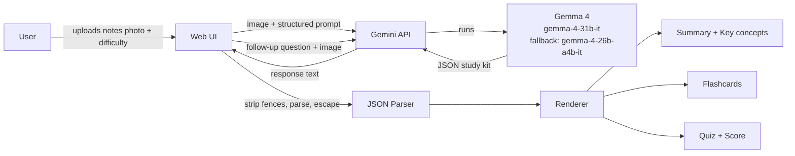

# 📸 Snap2Study

Turn a photo of your notes into a complete study kit in seconds, powered by **Gemma 4** through the Gemini API.

Built for the **Best Use of Gemma 4** challenge at Hacktoberfest Hack Day Hyderabad x Kramer's Community (MLH).

## What it does

Upload a photo of handwritten notes, a textbook page, or a whiteboard. Gemma 4 reads the image directly (no separate OCR step) and generates:

- A plain-language **summary** and **key concepts**
- 6 flip-able **flashcards**
- A 4-question interactive **quiz** with instant feedback, explanations and a running score
- A **follow-up Q&A** box grounded in the uploaded page
- An adjustable **difficulty** level (beginner, intermediate, advanced)

## Architecture



### Request flow

1. **Upload:** the user drops in a JPG, PNG or WEBP image (max 8 MB) and picks a difficulty.
2. **Prompt:** the UI sends the image and a structured prompt to Gemma 4 through the Gemini API.
3. **Generate:** Gemma 4 reads the page and returns JSON: `title`, `summary`, `key_concepts`, `flashcards`, `quiz`.
4. **Parse:** the response is cleaned (markdown fences stripped, JSON extracted) and validated. If the model returns an `error` field, a friendly message is shown.
5. **Render:** the UI renders the summary, flip cards and the scored quiz. All model text is escaped before display.
6. **Follow-up:** questions reuse the same image as context, so answers stay grounded in the page.

### Components

| Component | Responsibility |
|---|---|
| Upload zone | Drag-and-drop, file type and size validation, image preview |
| Prompt builder | Combines the image, difficulty level and JSON schema instructions |
| Gemma 4 client | Calls the Gemini API, falls back to the smaller Gemma 4 model on failure |
| JSON parser | Strips code fences, extracts and validates JSON |
| Renderer | Summary, key concepts, flashcards, quiz and score |
| Follow-up tutor | Answers questions in under 150 words, using only the image |

## Why Gemma 4

- **Multimodal:** one model reads handwriting, printed text and diagrams, so there is no OCR pipeline.
- **Open weights, lightweight:** easy to prototype with through the Gemini API.
- **Structured output:** reliably returns JSON that maps directly to UI components.

## Tech stack

Gemma 4 · Gemini API · Google AI Studio · JavaScript / HTML / CSS

## Run locally

```bash
git clone https://github.com/amangithub01/snap2study.git
cd snap2study
```

1. Get an API key at https://aistudio.google.com/apikey
2. Add the key as an environment variable (never commit it):

```bash
export GEMINI_API_KEY=your_key_here
```

3. Start the app and open it in your browser.

## Project structure

```
snap2study/
├── index.html        # UI and client logic
├── README.md
└── .gitignore        # keeps .env / API keys out of git
```

## Roadmap

- Multi-page notes (several photos in one kit)
- Export flashcards to Anki
- Regional language support (Telugu, Hindi)
- Spaced-repetition review mode

## Author

**Aman Kumar** · [@amangithub01](https://github.com/amangithub01)
